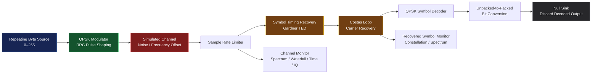

# 📡 SDR QPSK Link Testbench

  <b>A Software-Defined Radio Simulation for Digital Communication</b>
   
  GNU Radio Companion · QPSK · DSP · Signal Visualization

  
  
  
  

## 🚀 Overview

The **SDR QPSK Link Testbench** is a software-only digital communication simulation built using GNU Radio Companion (GRC).

It demonstrates how a digital byte stream is modulated using Quadrature Phase Shift Keying (QPSK), passed through a simulated communication channel, and processed by a receiver using timing recovery, carrier recovery, and symbol decoding.

The flowgraph also provides real-time signal visualization to help understand the effects of channel noise and the behaviour of a digital communication receiver.

## ⚙️ System Architecture

## 🔄 How the Flowgraph Works

### 1. Digital Signal Source

A built-in repeating vector source generates byte values from `0` to `255`. This provides deterministic test data without requiring an external input file.

### 2. QPSK Modulation

The Constellation Modulator maps the input data to QPSK symbols and generates a complex baseband signal using root-raised-cosine pulse shaping.

### 3. Simulated Communication Channel

The Channel Model introduces configurable noise, frequency offset, and sampling-rate mismatch.

These parameters can be modified to study how channel impairments affect signal recovery.

### 4. Sample Rate Control

The Throttle block limits the software processing rate to avoid unnecessary CPU usage in a hardware-free simulation.

### 5. Symbol Timing Recovery

The Symbol Sync block uses the Gardner timing error detector to recover symbol timing from the received complex samples.

### 6. Carrier Recovery

The Costas Loop compensates for carrier phase and frequency errors within its operating range. It is configured for QPSK.

### 7. Symbol Decoding

The Constellation Decoder converts recovered complex symbols into their corresponding symbol decisions. The Unpacked-to-Packed block then packs the decoded bits into bytes.

### 8. Signal Visualization

Two QT GUI sinks provide visual feedback:

- **Channel Monitor:** Frequency spectrum, waterfall, time-domain signal, and IQ constellation.
- **Recovered Symbol Monitor:** Recovered-symbol time-domain, frequency, waterfall, and constellation views.

The decoded byte stream currently terminates at a Null Sink; the flowgraph does not save the recovered bytes to a file.

## 🧩 Main Blocks and Parameters

| Block / Variable | Configuration |
|---|---|
| Sample rate (`fs`) | 1 MS/s |
| Samples per symbol (`sps`) | 4 |
| RRC roll-off (`rolloff`) | 0.35 |
| Channel noise (`noise`) | 0.0 initially |
| Constellation | QPSK |
| Timing recovery | Gardner TED |
| Carrier recovery | Costas Loop, order 4 |
| Output monitoring | QT GUI sinks |

## 🛠️ Requirements

- GNU Radio Companion 3.10.x
- Qt GUI support
- A compatible Python environment installed with GNU Radio

No RTL-SDR, USRP, external data files, or custom Python scripts are required by this flowgraph.

## ▶️ How to Run

1. Install GNU Radio through a compatible distribution such as Radioconda.
2. Download or clone this repository.
3. Open `SDR_QPSK_Telemetry_ShortVars.grc` in GNU Radio Companion.
4. Keep the channel noise variable at `0.0` for the initial test.
5. Click **Run** to launch the simulation.
6. Observe the channel spectrum and recovered-symbol constellation.
7. Increase the noise variable gradually and rerun the flowgraph to compare the visual output.

## 🧪 Suggested Experiments

| Experiment | Change | Observation |
|---|---|---|
| Noise-free baseline | `noise = 0.0` | Observe the signal and recovered constellation |
| Noise variation | Increase `noise` gradually | Observe constellation spreading and spectrum changes |
| Timing mismatch | Modify channel `epsilon` slightly from `1.0` | Study timing recovery behaviour |
| Frequency offset | Increase `freq_offset` slightly from `0.0` | Observe carrier-recovery behaviour |

Use small changes initially. The numerical values of the Channel Model parameters are not direct dB or Hz settings in this flowgraph.

## 📚 Concepts Demonstrated

- Digital QPSK modulation and symbol decoding
- Complex baseband signal representation
- Root-raised-cosine pulse shaping
- Simulated channel impairments
- Symbol timing recovery using Gardner TED
- Carrier recovery using a Costas Loop
- IQ constellation and spectrum visualization
- GNU Radio Companion block-based system design

## ⚠️ Current Scope and Limitations

This project is a **QPSK link simulation and visualization testbench**, not a complete telemetry receiver.

The current flowgraph does not implement:

- Telemetry packet framing or frame synchronization
- CRC validation
- BER or packet-delivery calculations
- Saving decoded bytes to an output file
- An actual RF transmitter or receiver

These are possible future extensions. They should only be claimed as implemented after they have been added and tested.

## 🔮 Future Improvements

- Add packet framing and frame synchronization.
- Implement CRC-based packet validation.
- Save recovered bytes and compare them against transmitted data.
- Measure BER across different channel conditions.
- Generate quantitative plots of BER versus SNR.
- Extend the testbench to BPSK and other modulation schemes.

## 👨‍💻 Author

**Mohit Sharma**  
B.Tech Electrical Engineering | Aligarh Muslim University

Interested in digital signal processing, software-defined radio, RF communication, radar systems, and aerospace sensing technologies.

---

  <i>Learning digital communication systems through simulation, signal analysis, and reproducible experiments.</i>

